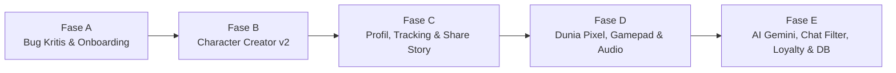

# Revisi & Roadmap Higround Run Club (v4)

> **Status:** Draft kompilasi revisi — **belum ada kode yang dieksekusi**. Tunggu konfirmasi user (Andreas) atas 6 pertanyaan terbuka di Bagian 4 atau arahan langsung mulai Fase A.  
> **Sumber:** Catatan revisi Andreas + 10 screenshot QA mobile dari tim internal (27 Nov 2026).

---

## 1. Peta Besar Revisi (Ringkasan per Kategori)

| Prioritas | Fokus | Dampak Utama |
|---|---|---|
| **Fase A (P0)** | Bug kritis mobile + Onboarding tanpa username + Fix Intervals.icu | Member baru bisa langsung daftar, connect jam, dan main lancar di HP tanpa HUD nabrak/peta macet |
| **Fase B (P1)** | Rombak Character Creator sesuai QA mobile + rapikan dock bawah | Karakter lebih lucu, ekspresif, proporsi topi pas, opsi simpel & nggak mubazir |
| **Fase C (P1)** | Rombak Profil/Dashboard (Walk, PB Badges, Heatmap 31 hari, Share per Run) | Dashboard relevan buat pelari & pejalan kaki, siap dipakai pamer ke IG Story |
| **Fase D (P2)** | Gameplay `/world` (Gamepad + Auto, Medal Top 1–3, Klik Profil, Playlist Higround, Menu & Review) | Dunia pixel beneran terasa kayak game sosial & nyambung ke ruko fisik Higround |
| **Fase E (P2–P3)** | Chatbot + Filter Kata Kasar ID, AI Assistant Gemini, Giveaway Email, Loyalty & Database Admin | Fitur retention, komunitas aman, dan integrasi bisnis kafe Higround |

---

## 2. Daftar Revisi Lengkap per Modul

### A. Onboarding & Login
- [ ] **Hilangkan input Username** setelah login lewat email/Google — cukup **1 kolom: Nama tampilan (= Nickname)**.
- [ ] **Aturan validasi Nickname:**
  - Boleh huruf besar/kecil (`Caps Lock` bebas), angka, dan spasi.
  - **Tidak boleh simbol dan emoji.**
  - *(Teknis: `handle` URL `/u/...` tetap di-generate otomatis & unik di belakang layar dari nickname supaya link profil & relasi DB tidak rusak.)*

### B. Integrasi Intervals.icu (Bug Fix)
- [ ] **Fix gagal connect di `/onboarding/connect`** (*"Tidak bisa masuk lewat interval icu"*).
- [ ] **Fix tombol Connect Intervals.icu di halaman Profil** (*"kenapa klik profile ga bisa connect interval"*).
- [ ] Pastikan pesan error jelas jika config/OAuth bermasalah, dan callback kembali mulus ke `/create` (saat onboarding) atau `/u/[handle]` (saat dari profil).

### C. Bug Kritis Mobile di `/world`
- [ ] **Fix HUD atas tumpang tindih di layar HP** *(QA Screenshot 16.41: bar `BGM / Mute / Cari gue / 1x 2x 3x` menimpa kartu profil kiri atas di viewport ~390px)*.
- [ ] **Fix Peta tidak bisa digeser-geser (touch pan/drag) di HP** *(QA Screenshot 16.48)*.
- [ ] **Fix karakter player tidak ketemu saat masuk `/world`** (*"kok player ga ketemu"*):
  - Pastikan karakter user selalu spawn di lokasi terlihat & kamera langsung auto-center ke karakter saat load + saat tekan `Cari gue`.
- [ ] **Tampilkan semua member yang sudah login** di tab **Aktif** dan di dalam peta (bukan cuma 1 orang).
- [ ] **Takeout tombol Karakter dari dock bawah** — pindahkan tombol **"Ganti Karakter"** ke lokasi yang lebih rapi (mis. kartu profil / halaman profil).
- [ ] **Yoga Quest di-lock sementara**: tetap tampil di UI (dengan ikon gembok / badge *Coming Soon*), tapi **tidak bisa diklik dulu**.

### D. Character Creator (`/create`)
- [ ] **Wajah & Mata:**
  - Perbanyak variasi mata (termasuk **mata sipit**).
  - Tambah ekspresi **negatif / lucu** (tidak harus selalu positif/senyum): mis. **Marah/Kesal, Cemberut, Ngantuk/Capek, Datar/Poker Face, Panik**.
- [ ] **Atasan (5 siluet berbeda saja):**
  - **Singlet**, **Kaos Pendek**, **Lengan Panjang**, **Jaket**, **Polo** *(hapus variasi motif yang siluetnya sama)*.
- [ ] **Bawahan (3 pilihan saja):**
  - **Panjang**, **Pendek**, **Dalaman**.
- [ ] **Sepatu (tambah gaya unik & lucu + palet warna):**
  - **Sepatu Biasa**, **Sendal Jepit**, **Nyeker**, **Sepatu Ice Skating**, **Sepatu Manjat Es (berpul)**, **Sepatu Bola**.
- [ ] **Topi & Topeng:**
  - **Perbaiki posisi/alignment semua topi** supaya pas menempel di kepala (sekarang beberapa topi melayang/meleset).
  - Tambah topi aneh/lucu & kategori **Topeng** (mis. Topeng Luchador, Topeng Hewan, Helm, Mahkota, dll).
- [ ] **Aksesori (disederhanakan jadi 3 pilihan saja):**
  - **Polos**, **Kacamata Biasa**, **Medali** *(buang Kacamata Hitam, Hydration Vest, Earphone)*.

### E. Gameplay & Interaksi di `/world`
- [ ] **Virtual Gamepad / D-Pad Cursor:**
  - Pemain bisa gerakin karakter sendiri pakai gamepad di layar (dan arrow/WASD di desktop).
  - Kalau gamepad **idle / tidak digerakkan** beberapa detik → karakter otomatis balik ke mode **Auto-Walk**.
- [ ] **Leaderboard interaktif di dalam dunia:**
  - Bisa diklik langsung dari papan di peta / menu → menampilkan **Leaderboard Lari berdasarkan Kilometer**.
- [ ] **Medali Unik Top 1, 2, 3 di atas kepala karakter:**
  - Juara 1 (Emas), Juara 2 (Perak), Juara 3 (Perunggu) punya **ikon medali unik melayang di atas kepala** karakternya di `/world` yang beda dari member lain.
- [ ] **Klik karakter / member lain → buka Profil mereka** (bisa cek stats, badge, & aktivitas member lain).
- [ ] **Menu Kafe Higround:** bisa buka daftar menu kopi/makanan langsung dari dalam app / POI Order Counter.
- [ ] **Lokasi & Review:** tombol cepat ke **Google Maps lokasi Higround** buat member kasih ulasan/review.
- [ ] **Musik BGM pakai Playlist Higround:** ganti synth prosedural dengan lagu dari playlist resmi Higround (dengan tombol play/pause & ganti track).

### F. Profil & Dashboard Member (`/u/[handle]`)
- [ ] **Track Jalan Kaki (`Walk`)** selain lari — ikut muncul di dashboard.
- [ ] **Hilangkan Elevasi** dari kartu statistik profil.
- [ ] **Tampilkan Kilometer per Minggu** secara jelas.
- [ ] **Heatmap diperjelas konteksnya:**
  - Khusus **1 bulan terakhir = 31 kotak** (lengkap dengan judul *"Aktivitas 31 Hari Terakhir"*, label, dan legenda intensitas).
- [ ] **Personal Best (PB) dengan Badge Sendiri:**
  - **1K**, **5K**, **10K**, **21K (HM)**, **42K (FM)**, **50K (Ultra)** — masing-masing punya desain badge PB sendiri.
- [ ] **Pemisahan kategori Badge:**
  - **Run Badge** (termasuk PB Badges)
  - **Yoga Badge** *(siap ditampilkan terpisah / locked)*
- [ ] **Aktivitas Lari + Share per Run:**
  - Daftar aktivitas lari lengkap, tiap item aktivitas punya tombol **Share Story** khusus untuk sesi lari itu.
- [ ] **Hapus bagian Riwayat XP** (*"riwayat xp ga usa"*).
- [ ] **Tombol Ganti Karakter** langsung dari halaman Profil.

### G. Share IG Story (`/share`) — *Perlu Finalisasi Layout*
- [ ] Dukungan **Share per Run** (data diambil dari 1 aktivitas lari spesifik: jarak, pace, durasi, tanggal, lokasi/start gate, badge PB kalau pecah rekor, plus avatar pixel member).
- [ ] **Review opsi layout 9:16** sebelum dikerjakan (Full Pixel Card vs Transparent Sticker Overlay ala Strava/NRC vs kombinasi).

### H. Klub, Giveaway, Database & Loyalty Member
- [ ] **Klub & Quest + Giveaway** *(QA Screenshot 16.47)*:
  - Misi KM Mingguan & Milestone Jumlah Member → benefit jelas berupa **Giveaway Free Drinks** untuk kontributor.
  - Mekanisme info pemenang/giveaway dikirim **melalui email**.
- [ ] **Database Member Terkumpul (Admin):**
  - Halaman/export admin yang mengumpulkan data member rapi (email, nickname, tanggal gabung, total km, kontribusi misi, status loyalty) untuk keperluan giveaway & CRM.
- [ ] **Integrasi Loyalty Member Higround:**
  - Sinkronisasi poin/stamp/voucher dengan program loyalty kafe Higround.

### I. Chat Komunitas & AI Assistant (Gemini)
- [ ] **Live Chat / Chatbot Komunitas + Filter Kata Kasar Bahasa Indonesia:**
  - Kamus profanity filter Bahasa Indonesia (termasuk variasi ejaan/leetspeak umum) agar member tidak bisa kirim kata kasar.
- [ ] **AI Assistant bertenaga Gemini API:**
  - Asisten AI di dalam app pakai Gemini API (mis. Running Coach berdasarkan data lari member, rekomendasi menu Higround, info jadwal event/klub).

---

## 3. Roadmap Eksekusi Bertahap (Rekomendasi Urutan)

| Fase | Ruang Lingkup | Estimasi Kompleksitas |
|---|---|---|
| **Fase A — Stabilisasi & Flow Inti** | Hapus Username (Nickname only, no symbol/emoji), Fix Intervals.icu (onboarding + profil), Fix HUD mobile tumpang tindih, Fix touch-pan peta HP, Fix player tidak ketemu, Member aktif tampil semua, Lock Yoga Quest, Takeout tombol Karakter di dock bawah | Cepat–Sedang |
| **Fase B — Character Creator v2** | Mata sipit + wajah negatif/lucu, 5 Atasan, 3 Bawahan, 6 Sepatu unik, Fix alignment Topi + Topeng, 3 Aksesori | Sedang |
| **Fase C — Profil & Share Story v2** | Track Jalan Kaki, hapus Elevasi & Riwayat XP, KM/minggu, Heatmap 31 hari jelas, PB Badges (1K–50K), pisah Run vs Yoga Badge, Share per Run + layout baru | Sedang |
| **Fase D — Dunia Pixel & Fitur Kafe** | Virtual Gamepad + auto-walk fallback, Leaderboard KM clickable, Medali Top 1–3 di atas kepala, Klik profil orang lain, Menu Higround, Lokasi & Review, BGM Playlist Higround | Sedang–Tinggi |
| **Fase E — AI, Komunitas & Bisnis** | Chat + Filter Kata Kasar Indonesia, AI Assistant Gemini, Giveaway Email Automation, Export Database Admin, Integrasi Loyalty Member | Tinggi (butuh API key & detail sistem eksternal) |

---

## 4. Pertanyaan Terbuka Sebelum Mulai Eksekusi

1. **Jalan Kaki (`Walk`) vs Leaderboard Lari:**
   - Cukup tampil di dashboard & heatmap profil saja, atau ikut dihitung masuk **Leaderboard KM** juga?
2. **Layout Share Story (9:16):**
   - Pilih **Opsi 1 — Full Pixel Card** (background diorama ruko Higround + avatar + stats), **Opsi 2 — Transparent Sticker Overlay** (PNG transparan buat ditempel di atas foto lari di IG Story), atau kombinasi keduanya?
3. **BGM Playlist Higround:**
   - Pakai file MP3/audio yang di-host sendiri (bebas hak cipta/lisensi kafe) atau embed Spotify/YouTube? *(Catatan: embed Spotify gratis hanya memutar preview 30 detik jika user belum login Spotify di browser.)*
4. **Menu & Link Lokasi Review:**
   - Minta link resmi **Google Maps Higround** dan daftar/link **Menu kafe** dari user.
5. **Integrasi Loyalty Member & Email Giveaway:**
   - Kafe Higround memakai POS/loyalty apa (Majoo, Moka, ESB, Olsera, atau internal)?
   - Email giveaway dikirim otomatis (mis. Resend / SMTP) atau cukup export daftar email pemenang dulu dari Admin?
6. **AI Assistant Gemini:**
   - Sudah ada `GEMINI_API_KEY` (Google AI Studio)? Fokus utamanya **Running Coach**, **CS/Concierge Kafe & Event Higround**, atau keduanya?
