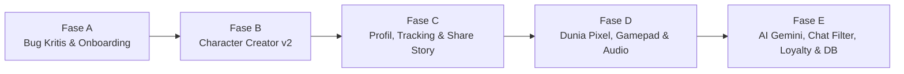

# Revisi & Roadmap Higround Run Club (v4)

> **Status:** Keputusan 1–7 terkunci — **Fase A selesai** (lanjut Fase B).  
> **Sumber:** Catatan revisi Andreas + 10 screenshot QA mobile + feedback WA tim internal (27–28 Nov 2026).

---

## 1. Peta Besar Revisi (Ringkasan per Kategori)

| Prioritas | Fokus | Dampak Utama |
|---|---|---|
| **Fase A (P0)** | Bug kritis mobile + Onboarding tanpa username + Fix Intervals.icu | Member baru bisa langsung daftar, connect jam, dan main lancar di HP tanpa HUD nabrak/peta macet |
| **Fase B (P1)** | Rombak Character Creator sesuai QA mobile (siluet lebih smooth & kebaca) + rapikan dock bawah | Karakter lebih lucu, ekspresif, baju/celana kelihatan jelas bedanya, proporsi topi pas |
| **Fase C (P1)** | Rombak Profil/Dashboard (Walk, PB Badges, Heatmap 31 hari, Share per Run, Deteksi Lari Bareng) | Dashboard relevan buat pelari & pejalan kaki, siap pamer ke IG Story (Card + Stiker) |
| **Fase D (P2)** | Gameplay `/world` (Gamepad + Auto, Medal Top 1–3, Klik Profil, Embed Playlist Higround, Menu & Review) | Dunia pixel beneran terasa kayak game sosial & nyambung ke ruko fisik Higround |
| **Fase E (P2–P3)** | Chatbot + Filter Kata Kasar ID, AI Running Coach Gemini (di Profil), Giveaway Resend, LunaPOS Monthly Sync & DB Admin | Fitur retention, komunitas aman, dan integrasi bisnis kafe Higround |

---

## 2. Daftar Revisi Lengkap per Modul

### A. Onboarding & Login
- [x] **Hilangkan input Username** setelah login lewat email/Google — cukup **1 kolom: Nama tampilan (= Nickname)**.
- [x] **Aturan validasi Nickname:**
  - Boleh huruf besar/kecil (`Caps Lock` bebas), angka, dan spasi.
  - **Tidak boleh simbol dan emoji.**
  - *(Teknis: `handle` URL `/u/...` tetap di-generate otomatis & unik di belakang layar dari nickname supaya link profil & relasi DB tidak rusak.)*

### B. Integrasi Intervals.icu (Bug Fix)
- [x] **Fix gagal connect di `/onboarding/connect`** (*"Tidak bisa masuk lewat interval icu"*).
- [x] **Fix tombol Connect Intervals.icu di halaman Profil** (*"kenapa klik profile ga bisa connect interval"*).
- [x] Pastikan pesan error jelas jika config/OAuth bermasalah, dan callback kembali mulus ke `/create` (saat onboarding) atau `/u/[handle]` (saat dari profil).

### C. Bug Kritis Mobile di `/world`
- [x] **Fix HUD atas tumpang tindih di layar HP portrait** *(QA Screenshot 16.41 & WA 19.34: bar `BGM / Mute / Cari gue / 1x 2x 3x` menimpa kartu profil kiri atas & Misi Klub di viewport portrait ~390px sehingga susah diklik)*.
- [x] **Fix Peta tidak bisa digeser-geser (touch pan/drag) di HP** *(QA Screenshot 16.48)*.
- [x] **Fix karakter player tidak ketemu saat masuk `/world`** (*"kok player ga ketemu"*):
  - Pastikan karakter user selalu spawn di lokasi terlihat & kamera langsung auto-center ke karakter saat load + saat tekan `Cari gue`.
- [x] **Tampilkan semua member yang sudah login** di tab **Aktif** dan di dalam peta (bukan cuma 1 orang).
- [x] **Takeout tombol Karakter dari dock bawah** — pindahkan tombol **"Ganti Karakter"** ke lokasi yang lebih rapi (mis. kartu profil / halaman profil).
- [x] **Yoga Quest di-lock sementara**: tetap tampil di UI (dengan ikon gembok / badge *Coming Soon*), tapi **tidak bisa diklik dulu**.

### D. Character Creator (`/create`)
- [ ] **Keterbacaan & Smoothness Pixel Sprite (Feedback WA):**
  - Upgrade siluet, shading, dan kontras antara atasan & bawahan agar di preview Character Creator & dunia game perbedaan jenis baju/celana kelihatan jelas dan lebih halus/rapi.
- [ ] **Wajah & Mata:**
  - Perbanyak variasi mata (termasuk **mata sipit**).
  - Tambah ekspresi **negatif / lucu** (tidak harus selalu positif/senyum): mis. **Marah/Kesal, Cemberut, Ngantuk/Capek, Datar/Poker Face, Panik**.
- [ ] **Atasan (5 siluet berbeda saja):**
  - **Singlet**, **Kaos Pendek**, **Lengan Panjang**, **Jaket**, **Polo** *(hapus variasi motif yang siluetnya sama)*.
- [ ] **Bawahan (3 pilihan saja):**
  - **Panjang**, **Pendek**, **Dalaman**.
- [ ] **Sepatu (tambah gaya unik & lucu + palet warna):**
  - **Sepatu Biasa**, **Sendal Jepit**, **Nyeker**, **Sepatu Ice Skating**, **Sepatu Manjat Es (berpul)**, **Sepatu Bola**.
- [ ] **Topi & Topeng:**
  - **Perbaiki posisi/alignment semua topi** supaya pas menempel di kepala (sekarang beberapa topi melayang/meleset).
  - Tambah topi aneh/lucu & kategori **Topeng** (mis. Topeng Luchador, Topeng Hewan, Helm, Mahkota, dll).
- [ ] **Aksesori (disederhanakan jadi 3 pilihan saja):**
  - **Polos**, **Kacamata Biasa**, **Medali** *(buang Kacamata Hitam, Hydration Vest, Earphone)*.

### E. Gameplay & Interaksi di `/world`
- [ ] **Virtual Gamepad / D-Pad Cursor:**
  - Pemain bisa gerakin karakter sendiri pakai gamepad di layar (dan arrow/WASD di desktop).
  - Kalau gamepad **idle / tidak digerakkan** beberapa detik → karakter otomatis balik ke mode **Auto-Walk**.
- [ ] **Leaderboard interaktif di dalam dunia:**
  - Bisa diklik langsung dari papan di peta / menu → menampilkan **Leaderboard Lari berdasarkan Kilometer** *(khusus Lari; Walk tidak masuk leaderboard)*.
- [ ] **Medali Unik Top 1, 2, 3 di atas kepala karakter:**
  - Juara 1 (Emas), Juara 2 (Perak), Juara 3 (Perunggu) punya **ikon medali unik melayang di atas kepala** karakternya di `/world` yang beda dari member lain.
- [ ] **Klik karakter / member lain → buka Profil mereka** (bisa cek stats, badge, & aktivitas member lain).
- [ ] **Menu Kafe Higround:** bisa buka daftar menu kopi/makanan langsung dari dalam app / POI Order Counter.
- [ ] **Lokasi & Review:** tombol cepat ke **Google Maps lokasi Higround** (`https://maps.app.goo.gl/zWJ7nExLghEzYQjm9`) buat member kasih ulasan/review.
- [ ] **Musik BGM pakai Embed Playlist Higround (Spotify/YouTube):** drawer/mini-player embed playlist resmi Higround di `/world` (dengan toggle buka/tutup + tetap ada SFX 8-bit Tone.js).

### F. Profil & Dashboard Member (`/u/[handle]`)
- [ ] **Track Jalan Kaki (`Walk`)** selain lari — ikut muncul di dashboard & heatmap profil *(tidak ikut Leaderboard Lari)*.
- [ ] **Hilangkan Elevasi** dari kartu statistik profil.
- [ ] **Tampilkan Kilometer per Minggu** secara jelas.
- [ ] **Heatmap diperjelas konteksnya:**
  - Khusus **1 bulan terakhir = 31 kotak** (lengkap dengan judul *"Aktivitas 31 Hari Terakhir"*, label, dan legenda intensitas).
- [ ] **Personal Best (PB) dengan Badge Sendiri:**
  - **1K**, **5K**, **10K**, **21K (HM)**, **42K (FM)**, **50K (Ultra)** — masing-masing punya desain badge PB sendiri.
- [ ] **Pemisahan kategori Badge:**
  - **Run Badge** (termasuk PB Badges)
  - **Yoga Badge** *(siap ditampilkan terpisah / locked)*
- [ ] **Aktivitas Lari + Share per Run:**
  - Daftar aktivitas lari lengkap, tiap item aktivitas punya tombol **Share Story** khusus untuk sesi lari itu.
- [ ] **Deteksi Lari Bareng Member Lain (*Run Buddy / Group Run* — Feedback WA):**
  - Backend otomatis mendeteksi aktivitas di hari yang sama dengan `start_time` berdekatan (mis. ≤15 menit) dan `start_lat/start_lng` dalam radius berdekatan (mis. ≤250 m — baik saat start dari Higround maupun lokasi lain).
  - Koordinat GPS **tidak pernah diekspos ke publik**; yang tampil hanya tag *"Lari bareng @Nama"* + statistik/riwayat partner lari di profil & Misi Klub.
- [ ] **Hapus bagian Riwayat XP** (*"riwayat xp ga usa"*).
- [ ] **Tombol Ganti Karakter** langsung dari halaman Profil.

### G. Share IG Story (`/share`)
- [ ] Dukungan **Share per Run** (data diambil dari 1 aktivitas lari spesifik: jarak, pace, durasi, tanggal, lokasi/start gate, badge PB kalau pecah rekor, plus avatar pixel member).
- [ ] Dukungan **Share Lari Bareng (*Run Buddy*)**: kalau sesi lari terdeteksi bareng member lain, tampilkan badge *"Lari bareng @Nama"* + jajaran avatar pixel squad langsung di kartu/stiker IG Story.
- [ ] **Dua Mode Layout 9:16 (Toggle):**
  - **Card Pixel** (background diorama ruko Higround + avatar + stats)
  - **Stiker Transparan** (PNG transparan buat ditempel di atas foto lari di IG Story ala Strava/NRC)

### H. Klub, Giveaway, Database & Loyalty Member
- [ ] **Klub & Quest + Giveaway** *(QA Screenshot 16.47)*:
  - Misi KM Mingguan & Milestone Jumlah Member → benefit jelas berupa **Giveaway Free Drinks** untuk kontributor.
  - Pemenang giveaway dikirim notifikasi **email otomatis via Resend**.
- [ ] **Database Member Terkumpul (Admin):**
  - Halaman/export admin yang mengumpulkan data member rapi (email, nickname, tanggal gabung, total km, kontribusi misi, status loyalty) untuk keperluan giveaway & CRM.
- [ ] **Integrasi Loyalty Member Higround (LunaPOS):**
  - Karena LunaPOS tidak menyediakan public open API, integrasi memakai **Monthly CSV/Excel Upload Sync** di `/admin` (cocokkan via email / no. HP untuk update status/poin loyalty member), ditambah tombol export siap pakai.

### I. Chat Komunitas & AI Running Coach (Gemini)
- [ ] **Live Chat / Chatbot Komunitas + Filter Kata Kasar Bahasa Indonesia:**
  - Kamus profanity filter Bahasa Indonesia (termasuk variasi ejaan/leetspeak umum) agar member tidak bisa kirim kata kasar.
- [ ] **AI Running Coach bertenaga Gemini API (di Dashboard Profil):**
  - Fokus khusus sebagai **Running Coach** yang membaca histori lari member (volume mingguan, tren pace, konsistensi, PB, recovery) langsung di halaman `/u/[handle]`.

---

## 3. Roadmap Eksekusi Bertahap

| Fase | Ruang Lingkup | Status |
|---|---|---|
| **Fase A — Stabilisasi & Flow Inti** | Hapus Username (Nickname only, no symbol/emoji), Fix Intervals.icu (onboarding + profil), Fix HUD mobile portrait tumpang tindih, Fix touch-pan peta HP, Fix player tidak ketemu, Member aktif tampil semua, Lock Yoga Quest, Takeout tombol Karakter di dock bawah | **Done** |
| **Fase B — Character Creator v2** | Smoothness & kontras siluet baju/celana, Mata sipit + wajah negatif/lucu, 5 Atasan, 3 Bawahan, 6 Sepatu unik, Fix alignment Topi + Topeng, 3 Aksesori | Next |
| **Fase C — Profil, Run Buddy & Share Story v2** | Track Jalan Kaki (`Walk`), hapus Elevasi & Riwayat XP, KM/minggu, Heatmap 31 hari jelas, PB Badges (1K–50K), pisah Run vs Yoga Badge, Deteksi Lari Bareng (*Run Buddy*), Share per Run + Share Lari Bareng (Card Pixel + Stiker Transparan) | Pending |
| **Fase D — Dunia Pixel & Fitur Kafe** | Virtual Gamepad + auto-walk fallback, Leaderboard KM (khusus Lari) clickable, Medali Top 1–3 di atas kepala, Klik profil orang lain, Menu Higround, Link Google Maps Review, Embed BGM Playlist Higround | Pending |
| **Fase E — AI Coach, Komunitas & Bisnis** | AI Running Coach Gemini di Profil, Chat + Filter Kata Kasar Indonesia, Giveaway Email via Resend, Export Database Admin, LunaPOS Monthly CSV/Excel Loyalty Sync | Pending |

---

## 4. Keputusan Terkunci (Finalized)

1. **Jalan Kaki (`Walk`) vs Leaderboard Lari:** **Opsi A** — `Walk` tampil di dashboard & heatmap profil, **Leaderboard KM tetap khusus Lari**.
2. **Layout Share Story (9:16):** **Opsi C** — **Card Pixel** + **Stiker Transparan (PNG)** dengan toggle di `/share`.
3. **BGM Playlist Higround:** **Opsi B** — **Embed Spotify/YouTube** Playlist Higround *(dengan mini-drawer player agar nggak mengganggu peta & catatan preview 30 detik jika user tidak login Spotify di browser)*.
4. **Menu Kafe & Link Google Maps Review:**
   - Google Maps: `https://maps.app.goo.gl/zWJ7nExLghEzYQjm9`
   - Menu Kafe (Drive — **akses terverifikasi**): `higround_operational_menu offline_compressed (1).pdf` (`https://drive.google.com/file/d/1uxWolkAArosG4Nlxr2NGkjSPRFI3wUGa/view?usp=sharing`, 5.1 MB) → siap diekstrak ke `config/cafe_menu.json` + link lihat PDF penuh di Fase D.
5. **Loyalty Member (LunaPOS) & Giveaway Email:**
   - POS: **LunaPOS** (`lunapos.id`) → **Monthly CSV Upload Sync** di `/admin`.
   - Giveaway email: kirim otomatis lewat **Resend** (`RESEND_API_KEY`).
6. **AI Assistant Gemini:**
   - Fokus utama: **Running Coach** yang membaca histori lari member langsung di **Dashboard Profil** *(key `GEMINI_API_KEY` menyusul; UI kasih graceful state sampai key diisi)*.
   - Panduan setup `GEMINI_API_KEY`:
     1. Buka [aistudio.google.com/apikey](https://aistudio.google.com/apikey) pakai akun Google/Gemini yang mau dipakai kuotanya.
     2. Klik **Create API key** → pilih/buat Google Cloud Project → salin key (`AIza...`).
     3. Di Mac mini (`~/higround-runclub-web/run-club/apps/web/.env.local`), tambahkan `GEMINI_API_KEY=AIza...` (jangan pernah di-commit ke git), lalu `pm2 restart runclub --update-env`.
     4. Pakai model hemat & cepat seperti `gemini-2.5-flash` (ada free tier di AI Studio; kalau trafik naik, tinggal aktifkan billing Pay-as-you-go di project tsb).
7. **Deteksi Lari Bareng (*Run Buddy / Group Run*) + Share Story:**
   - Otomatis dideteksi di backend dari tabel `activities` pada tanggal yang sama: cocokkan pasangan aktivitas member yang berbeda dengan selisih `start_time ≤ 15 menit` dan jarak Haversine `(start_lat, start_lng) ≤ 250 m` (baik di Higround maupun di rute/lokasi lain). Koordinat GPS tetap privat.
   - Hasil deteksi tampil di profil & **bisa langsung di-share ke IG Story** (`/share`) lengkap dengan avatar & nama partner lari bareng!

